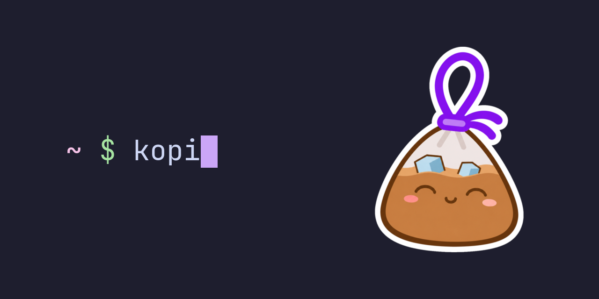

<p align="center"></p>

# Kopi

> **kopi** *(n.)*: coffee, in Singapore.
>
> Send a prompt, go for a kopi, come back to click approve.

Kopi is a terminal coding agent in Go, one binary, built on [PiG](https://github.com/MichaelKinsy/PiG). PiG runs the agent loop, sessions, providers, compaction, the MCP client and skill parsing; Kopi owns the interface, tools, subagents, workflows, permissions and the OS sandbox.
It starts in plan mode and asks before acting outside the sandbox.

## Install

With [Homebrew](https://brew.sh/) on macOS or Linux:

```sh
brew install keyute/tap/kopi
```

To build from source instead:

- Needs Go (version in `go.mod`) and [Task](https://taskfile.dev/) to build; the built binary needs nothing else at runtime.
- Builds for macOS, Linux and Windows; releases and CI cover macOS and Linux.

```sh
task build    # writes bin/kopi
```

## Quick start

```sh
kopi login                 # list providers
kopi login <provider>
```

Setting a model is optional. Without `model`, Kopi uses the default model of a provider with a credential, and with none the fullscreen interface asks which provider to log in to (see [configuration](docs/configuration.md#model)). To pick one, set it in `~/.kopi/config.json` (`$KOPI_HOME` overrides the home):

```json
{ "version": 1, "model": "openai-codex/gpt-5.6-luna" }
```

```sh
kopi                       # fullscreen interface, starts in plan mode
kopi -p "explain main.go"  # print mode
git diff | kopi -p "review this"
```

Shift+Tab or `/execute` switches from plan to execute mode.

## Documentation

- [Usage](docs/usage.md): fullscreen and print mode, commands, keys
- [Configuration](docs/configuration.md): `config.json`, key bindings, status line, themes
- [Providers](docs/providers.md): login, models, plan limits
- [Tools](docs/tools.md): modes, built-in tools, background tasks, web tools
- [Permissions](docs/permissions.md): rules, approval dialog, classifier
- [Sandbox](docs/sandbox.md): the OS sandbox for `Bash`
- [MCP servers](docs/mcp.md)
- [Trust and instructions](docs/trust.md): folder trust, `AGENTS.md`
- [Skills](docs/skills.md)
- [Subagents](docs/subagents.md)
- [Workflows](docs/workflows.md)

## Contributing

See [CONTRIBUTING.md](CONTRIBUTING.md).

## Credits

Built on [PiG](https://github.com/MichaelKinsy/PiG) by Michael Kinsy (MIT). Other dependencies are listed in `go.mod`.

The Seatbelt policy in `internal/sandbox/codex/` is adapted from [OpenAI Codex](https://github.com/openai/codex) (Apache-2.0); its `LICENSE` and `NOTICE` are in that directory. The Linux listener handoff in `internal/sandbox/handoff_linux.go` follows Codex's design; no code is copied. The Linux sandbox's mount plan in `internal/sandbox/bwrap.go` is adapted from Anthropic's [sandbox-runtime](https://github.com/anthropics/sandbox-runtime) (Apache-2.0); its `LICENSE` is in `internal/sandbox/srt/`. The domain entry syntax and matching in `internal/sandbox/domain.go` and the proxy environment variables follow the same project (same licence and `LICENSE`).

## License

MIT, see `LICENSE`.

<p align="center"><br><sub>Kopi peng, iced kopi in a takeaway bag.</sub></p>
